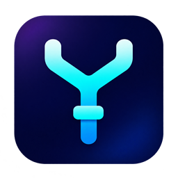

# 易音 · Yiyin

独立的 Windows 音频机架。**1.2.0 同步易控 1.6.3 的机架功能**，保留独立工程、配置、安装身份和图标。



**个人非商业使用免费，禁止商用。** 本项目公开源代码供个人学习、修改和非商业分享，采用 [易音个人非商业使用许可](LICENSE)。它是 source-available 项目，不是 OSI 定义的开源项目。商业演出、商业直播、收费录音/后期、企业经营和有偿服务等均不在免费许可范围内。

## 安装

在 [Releases](https://github.com/YiJunProject/Yiyin/releases) 下载 `Yiyin-v1.2.0-win-x64-Setup.exe`，退出旧版后覆盖安装。Windows 10/11 x64，自包含 .NET 运行时。安装包未数字签名。

既有 `.yiyin` 工程和 `%LOCALAPPDATA%\Yiyin` 配置继续使用。第三方 VST 插件、商业授权及声卡驱动需要自行安装。升级无需删除工程或重新扫描所有已有效记录的插件。

## 功能

- 音频 I/O 支持专业声卡＋USB 和普通多 USB。主输出可分送各设备左右声道，同组设备运行时支持试听、撤回与保存。
- ASIO / WASAPI 声卡 I/O，命名输入输出与自动建轨；新输入的监听由用户手动开启。
- VST2 / VST3 插件、原生编辑器、插件状态保存、BUS / FX、主输出与前后级发送。
- 多轨 Solo / Mute、FX 默认 Solo Safe；Shift 点击 S 切换 Solo Safe。
- 轨道设置、插件库分别显示；固定轨宽、模块分隔拖动、插入/发送收起、中键横向拖动。
- 推子与声像数值编辑、滚轮微调，声像双击回中；八种主题。
- 工程与机架快照、易控机架导入、Studio One 机架导入、局域网平板控制。

纯机架没有易控内部音视频播放器、灯光、视频或 MA2 控制。伴奏通过实际声卡输入或回送接入。易控内部播放轨导入时转换为 BUS 并提示，不会凭空提供原播放器信号。

## 构建

工具要求：Windows x64、`global.json` 指定的 .NET SDK、Visual Studio 2022 C++ 桌面工具、CMake 3.25+、Git；打包另需 Inno Setup 6（带简体中文语言文件）。工具不由构建脚本安装。

```powershell
# 固定官方依赖及现有补丁；只首次需要，下载位置为 third_party。
./scripts/prepare-native-deps.ps1
# 默认关闭 ASIO；支持 WASAPI、VST2、VST3。
./scripts/build-native.ps1
./scripts/build.ps1 -Output artifacts/publish/local
./scripts/build-installer.ps1 -PublishRoot artifacts/publish/local -Compiler 'C:\Program Files (x86)\Inno Setup 6\ISCC.exe'
```

ASIO 构建需要自己取得适用许可并提供匹配的 `asio.h`、`asiosys.h`、`iasiodrv.h`：

```powershell
./scripts/build-native.ps1 -EnableAsio -AsioInclude 'C:\licensed-asio\include'
```

SDK 头文件不会从仓库取得，`third_party`、构建结果、私有协议及用户数据不跟踪。固定依赖、源码适配和实际构建配置记录在 `native-audio/dependencies.v1.2.0.lock.json`；生成器重新构建时更新这个锁文件，旧版本锁保留。详见 [第三方声明](THIRD-PARTY-NOTICES.md)。

`src/Yiyin.App` 为 WPF 和本地平板服务，`src/Yiyin.Core` 为机架数据，`native-audio/src` 为音频宿主。内部 `LightDeck` 命名空间与 `Yideck.Audio.*` 子进程名称沿用协议身份。

## 验证范围

版本发布说明记录针对最终版本实际完成的检查。WPF 界面、离线合成音频、商业插件在开发电脑上的检查，不代表另一台电脑的 ASIO 现场声音、混合 DPI 或全部插件组合已验证。

使用方法见 [使用说明](使用说明.txt)。问题可通过 Issues 提交，请附版本、Windows/声卡/插件信息和最短复现步骤，不要上传密码、连接码、商业授权文件或私人工程。
